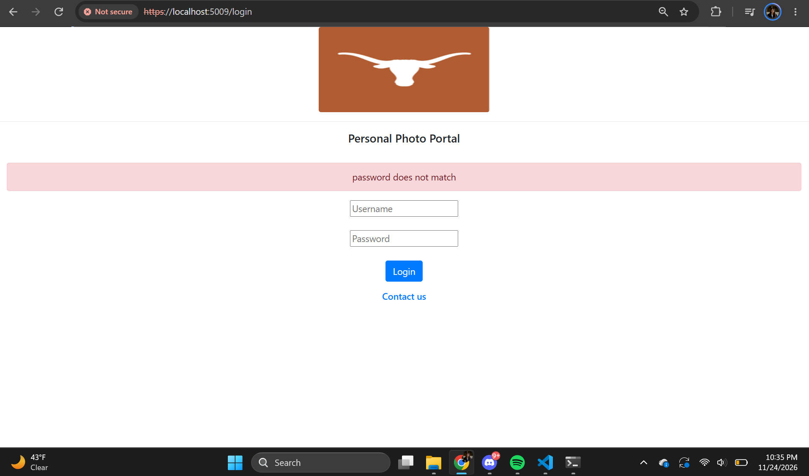
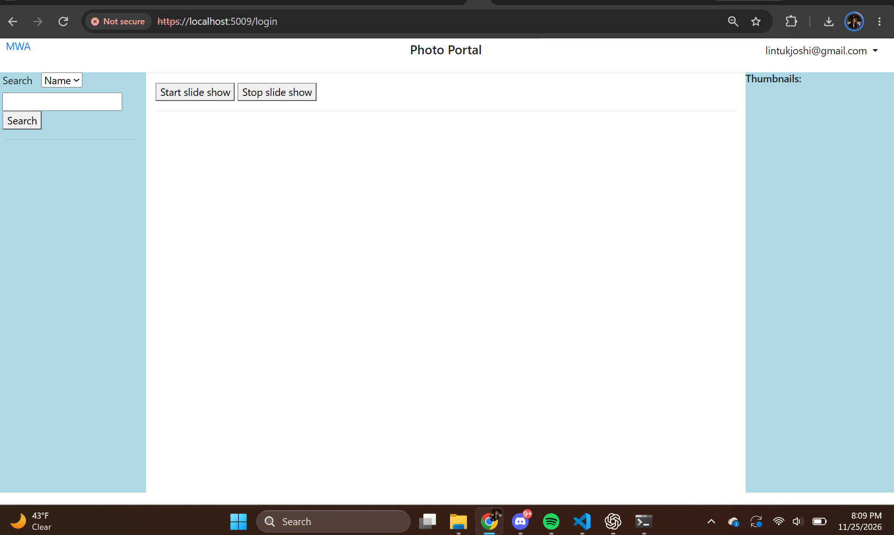

# Assignment 5 Reflection

The trickiest requirement was making the Google callback create exactly one general user record while keeping the account separate from the admin login. The starter code already exchanged the authorization code for Google credentials, but I needed a clear point to create the local account and assign the session role. I put that logic in the callback, after the state check and after Google provides a verified email. The callback stores the email in the user table with an empty password. A database uniqueness constraint prevents repeated or concurrent sign-ins from creating duplicate records. After the database step succeeds, Flask stores the email and role in the session and redirects to the portal.

I used the session role for access decisions throughout the photo portal. In particular, I changed the search and logout paths to read the role from the session. I also checked the role on the server for upload, tag updates, and deletion, since someone can make a POST request without using the form. The admin registration route hashes the password with bcrypt, and the account listing returns only the fields specified in the assignment.

For local testing, I ran the Flask app on port 5009 with its self-signed HTTPS certificate. I created an admin account, checked the stored bcrypt hash, and tried registering the same name twice. I submitted an unknown username and an incorrect password to verify the two different error messages. After a successful sign-in, I exercised photo upload, tag search, tag updates, deletion, and logout. I also tested the OAuth callback with a mocked Google response. Two sign-ins with the same verified email produced one general user, and a request to upload as that user returned HTTP 403. Live Google sign-in and the public EC2 URL still need verification.

*Requirement 2.5. The admin sign-in page displays “password does not match” when the username exists and the supplied password is incorrect.*

*Requirement 4. A successful admin sign-in opens the photo portal with the upload form and the existing photo controls.*
